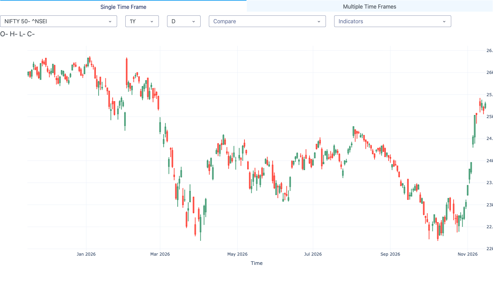
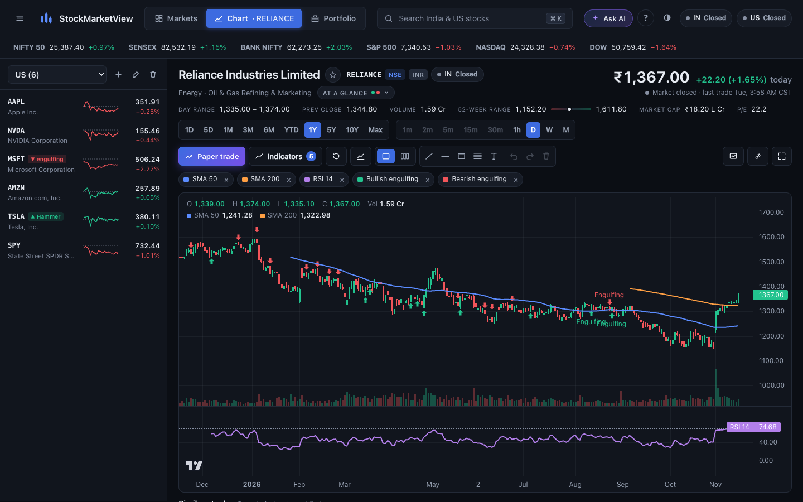
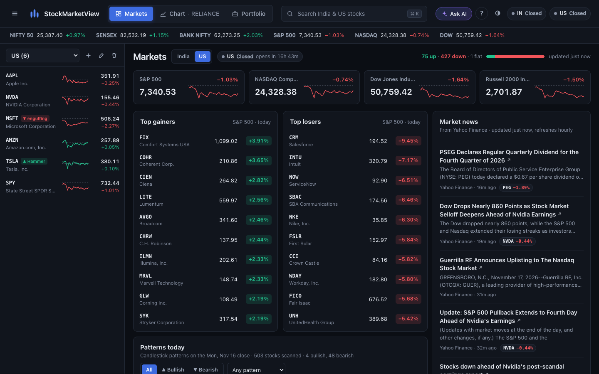
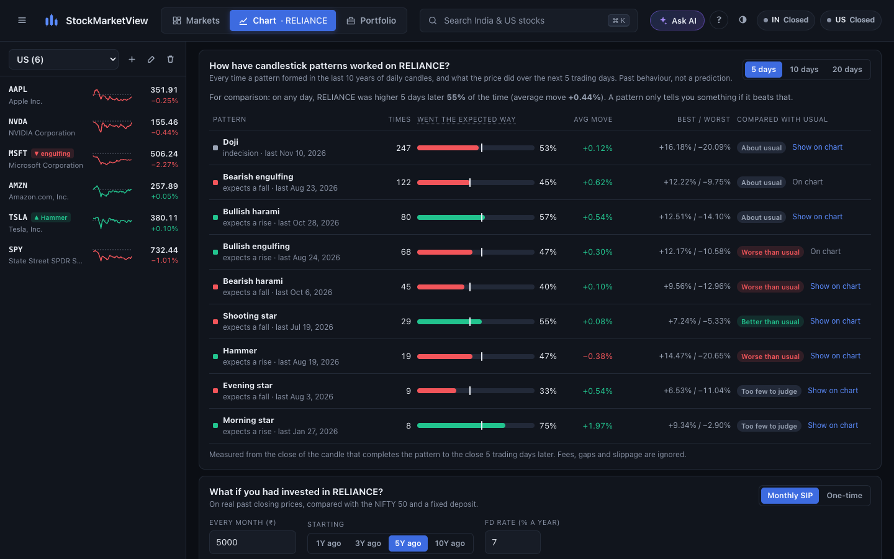
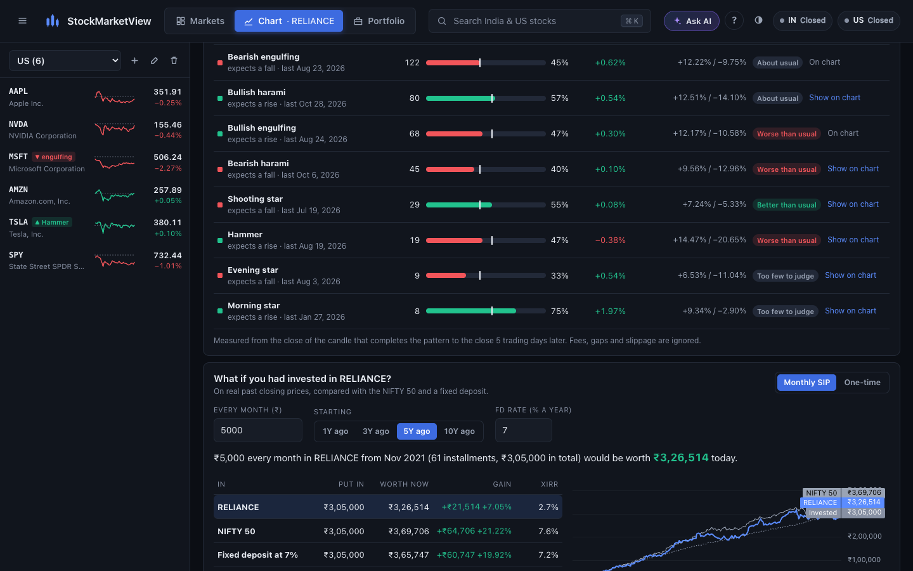
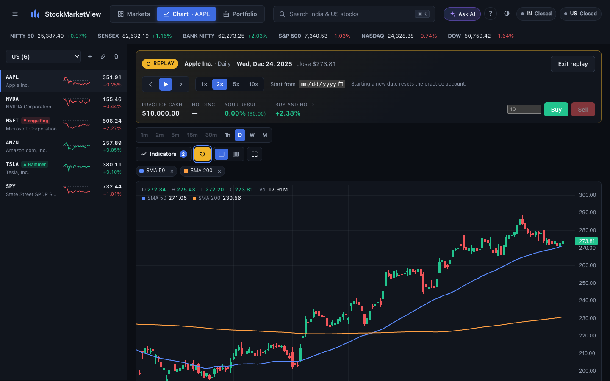
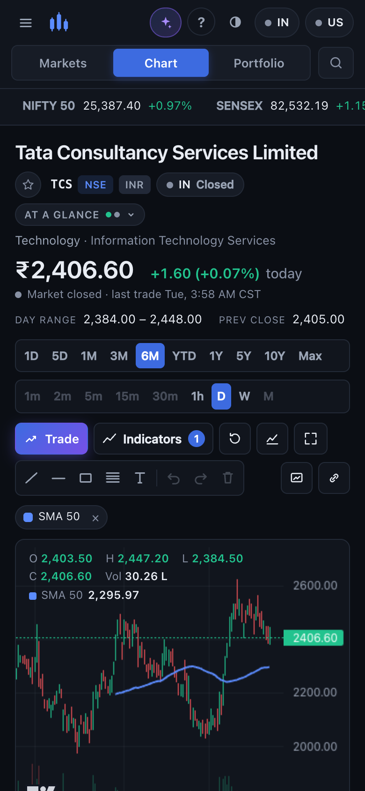

# StockMarketView v2

Free live stock charts for India (NSE, BSE) and the US (NYSE, NASDAQ). No sign-up, no ads, no paywall.

**Live site: https://stockmarketview.aishvaryaramesh.workers.dev**

This is a rebuild of [StockMarketView v1](https://github.com/AishvaryaRamesh08/StockMarketView) (2021, Python Dash + Plotly + TA-Lib),
which I wrote by hand during my undergrad degree. v2 was built with AI-assisted development (Claude Code); the
[comparison below](#v1-vs-v2) shows what changed.

## Status

| Phase | Scope | State |
|---|---|---|
| 1 | Data proxy, ticker search (India + US), live chart with period/interval chips, market status, deploy pipeline | **Done** |
| 2 | Indicators, candlestick patterns, plain-English summary, tooltips, key levels, fundamentals, compare, multi-timeframe, watchlists | **Done** |
| 3 | Market pulse landing page, scheduled data job, "patterns today" feed, similar stocks | **Done** |
| 4 | Drawing tools, PNG export, shareable URLs | **Done** |
| 5 | Paper trading | **Done** |
| 6 | Gemini chatbot (bring your own key), text then voice | **Done** |
| 7 | Visual polish, mobile and performance passes, v1-vs-v2 write-up | **Done** |

## v1 vs v2

| v1 (2021) | v2 (2026) |
|---|---|
|  |  |

| v2 Markets page | Pattern track record | What if you had invested | Replay | Phone |
|---|---|---|---|---|
|  |  |  |  |  |

### Measured

Both versions measured on the same laptop on 17 Nov 2026: v1 running locally (its code unchanged, on current Dash),
v2's production build running locally in Cloudflare's own runtime (`wrangler dev`). Lighthouse 12, cold load;
"mobile" is Lighthouse's simulated mid-range phone on slow 4G. The Markets page's mobile score varied between 84 and 96
across runs, depending on which data arrived first. v1's original Heroku address no longer exists
(Heroku ended its free plan in 2022), so it could not be measured online.

| | v1 | v2 Markets page | v2 Chart page |
|---|---:|---:|---:|
| Lighthouse performance, mobile | 38 | 96 | 91 |
| Lighthouse performance, desktop | 59 | 99 | 99 |
| Accessibility / Best practices / SEO | 86 / 100 / 82 | 100 / 100 / 100 | 100 / 100 / 100 |
| First contentful paint, mobile | 8.6 s | 1.9 s | 2.5 s |
| Largest contentful paint, mobile | 40.0 s | 2.5 s | 2.9 s |
| Page weight (cold load) | 7.3 MB | 0.2 MB | 0.2–0.3 MB |
| Requests every minute while a market is open | 2 full re-renders of each chart (about 25 KB each for one year of daily candles); the server re-downloads the whole history from Yahoo for every visitor | about 2.5 small requests (one batched quote request every 30 s, gainers and losers every 2 minutes), shared through an edge cache | about 4 small requests (the newest candles and one batched quote request, every 30 s), shared through a 20-second edge cache |
| Hosting | Heroku (paid since 2022) | Cloudflare Workers free plan | |
| Code | 1,085 lines of Python in two files | 16,379 lines of TypeScript and CSS, plus 1,540 lines of tests (185 tests) | |

### Features

| | v1 | v2 |
|---|---|---|
| Markets | NSE and BSE | NSE, BSE, NYSE and NASDAQ |
| Live updates | Re-downloads everything every 30 s | Only the newest candles every 30 s, while the market is open |
| Indicators | 4 SMAs, EMA 9, Bollinger Bands, Parabolic SAR | 12 indicators incl. Ichimoku, VWAP, RSI and MACD in their own panels |
| Candlestick patterns | Engulfing | 9 patterns, each with its 10-year track record on the stock |
| Compare, multi-timeframe | Yes | Yes, with synced crosshairs |
| Explanations | No | Plain-English summary, hover explanations everywhere, welcome guide |
| Market overview | No | Markets page: indices, breadth, gainers and losers, market news, daily pattern scan |
| Drawing, image export, share links | No | Yes |
| Watchlists | No | Yes |
| Paper trading | No | Virtual ₹ and $ accounts, P&L by stock and day, replay practice |
| Investing calculator | No | SIP and lump-sum "what if", against the index and a fixed deposit |
| Chatbot | Separate Rasa bot with fixed answers | Ask AI (Gemini, your own key): draws charts from text or voice, explains, reviews your paper portfolio |
| Machine learning | A random-forest experiment (`ml_randForest.py`) | Not carried over: the site describes the past, it doesn't predict |
| Phones | Desktop layout only | Designed for phones too, including touch drawing |

### What AI did and what I decided

**What the AI did:** proposed the plan and the hosting setup, wrote all of the code, tests and documentation, tested
every phase in a browser at desktop and phone sizes, measured performance, and found and fixed bugs before I saw them,
for example: Yahoo sending today's NSE candle empty (which made "previous close" wrong), a cancelled request that could
blank the page, queued paper orders that didn't set cash aside, a replay mode that let you trade with hindsight, and
headline matching that mistook "Nasdaq" the index for Nasdaq the company. It also cross-checked the pattern rules
against TA-Lib ([results](scripts/talib-check/README.md)).

**What I decided:**
- That it had to be free to run and free to use, live within 30 seconds, for both India and the US, in English.
- Which features to build from the AI's suggestions: plain-English summaries and explanations, key levels and
  fundamentals, the Markets page, daily pattern scans, similar stocks, paper trading, a bring-your-own-key Gemini
  chatbot with voice, and later the pattern track record, replay mode and the SIP calculator.
- Layout and product calls after using each phase: making the chart the focus of the page, a maximize mode, a
  prominent Paper trade button, a first-visit guide that stays up to date, replacing the heatmap with gainers, losers
  and market news (fewer requests and more useful), a faster default Gemini model after slow replies, P&L views for
  the paper portfolio, and an AI portfolio review that describes but never recommends.
- What reached the live site: every phase was reviewed locally before I approved deploying it.

## Features so far

- **Live charts** for NSE, BSE, NYSE and NASDAQ stocks and indices, refreshed every 30 seconds while the market is open.
- **Indicators** (unlimited): SMA 20/50/100/200, EMA 9/21, Bollinger Bands, Ichimoku, Parabolic SAR, VWAP, plus RSI and MACD in their own panels.
- **Candlestick patterns** marked on the chart: engulfing, hammer, shooting star, doji, morning/evening star, harami.
- **At a glance**: a plain-English summary of trend, RSI, MACD crossovers and recent patterns. Rule-based, no API key.
- **Hover explanations** for every indicator, pattern and stat, written for beginners.
- **Key levels**: 52-week high/low, previous day high/low, automatic support and resistance.
- **Fundamentals**: market cap, P/E, sector and industry; dividends and splits marked on the chart.
- **Compare** up to 4 stocks or indices as % change.
- **Multi-timeframe**: three charts of the same stock with synced crosshairs.
- **Watchlists**: multiple named lists with live prices, sparklines and pattern badges.
- **Markets page**: India/US toggle, index cards, market breadth, and the NIFTY 500 / S&P 500
  top gainers and losers, refreshed every 2 minutes while the market is open.
- **Market news**: the latest headlines beside the movers, each with a short snippet and a link to the full
  article on the publisher's site (nothing is copied or stored). India: The Economic Times and Mint; US: Yahoo
  Finance. Headlines that name an index stock show it with today's move ("NVDA −0.96%"), one click from its chart.
  Fetched from the publishers' RSS feeds at most once an hour per Cloudflare location.
- **Patterns today**: every NIFTY 500 and S&P 500 stock scanned for candlestick patterns after each close,
  ranked by unusual volume, with RSI; one click opens the chart with the pattern marked.
- **Similar stocks**: same-industry peers below the chart, with one-click compare.
- **Drawing tools**: trendline, horizontal level, rectangle, Fibonacci retracement and text notes. Select, drag to
  move, undo/redo (Cmd/Ctrl+Z), Delete to remove. Drawings are anchored to price and time, so they stay put when
  you change period or interval, and are saved per stock in this browser.
- **Replay**: step through a stock's past candles one at a time (or play them at 1–10 candles a second) from any
  start date, with the future hidden and indicators computed only from what has happened so far. A separate
  practice account (₹1,00,000 / $10,000) trades at each candle's close, and your result is shown against buy and
  hold. You can step back to look, but trades only happen on the furthest candle reached.
- **Pattern track record**: below the chart, every candlestick pattern's history on that stock over 10 years of
  daily candles: how many times it formed, how often the price went the expected way 5, 10 or 20 days later, the
  average, best and worst move, and whether that beats the stock's normal behaviour (its base rate).
- **What if you had invested**: a monthly SIP or a one-time investment in the stock from 1, 3 or 5 years ago, or from the
  earliest price available (Max: up to 10 years, or since the stock listed),
  on real split-adjusted closes, against the NIFTY 50 / S&P 500 and a fixed deposit, with XIRR or CAGR and a value
  chart. Dividends, taxes and fees are not included.
- **Image export**: download or copy the chart as a PNG with a caption (stock, timeframe, date) and no watermark.
- **Shareable links**: the address bar always describes the chart on screen (stock, period, interval, indicators,
  compare, layout), and Share copies it. Drawings are not part of links; share them as an image.
- **Paper trading**: virtual INR and USD wallets (₹10,00,000 and $100,000 by default), market, limit and stop
  orders, long-only and whole shares. Market orders placed while a market is closed fill at the first price after
  the open. Fills, working orders and average cost are drawn on the chart. A Portfolio page shows account value,
  cash, holdings, realised and unrealised P&L, an equity curve and full order history, with JSON export/import and
  reset. Click either P&L card to see which stocks made or lost money. **Trades & P&L** shows, for today, the last
  7 or 30 days or all time, what was invested, what sales brought in and the realised P&L, by stock or by day
  (in the exchange's own calendar), plus win rate and best/worst sale. Order history shows each sale's P&L. Orders are only checked while the site is open in a tab; fills ignore slippage, fees, dividends and splits.
- **Ask AI** (Gemini, bring your own key): type or say “show Reliance for a year with RSI”, “compare TCS with
  Infosys” or “what is a demat account?”. It drives the site through function calling (open charts, add or remove
  indicators, compare, multi-timeframe, quotes, chart summaries, Markets page, watchlist) and answers beginner
  questions carried over from the v1 Rasa bot. It can also review the paper portfolio ("how is my portfolio doing?", or
  **Analyse with AI** on the Portfolio page): overall return, what is up and down, concentration by stock and sector,
  today's movers and realised results, described from the account's own numbers. It never gives buy/sell
  recommendations and cannot place trades.
  The key is stored only in the visitor's browser and sent only to Google (in a request header, never a URL); it
  never reaches this site's Worker. The model is a setting (default `gemini-3.5-flash-lite`, the fastest); if it is overloaded, slow or out of
  quota the chat falls back to another Gemini model and says so. Voice input uses the
  browser's built-in speech recognition and is hidden where the browser lacks it.
- **Welcome guide**: a short first-visit introduction to the three pages and main features, reopened from **?**.
- **Maximize** (F): only the top bar, chart controls and chart.
- **Appearance**: dark and light themes, plus a colour-blind-friendly blue/orange palette for up/down.
- **Command palette** (Cmd/Ctrl+K): search stocks, or type a command such as "light theme", "show RSI" or "go to markets".
- **Starts on the chart, remembers your setup**: every visit opens the Chart tab with your last stock, timeframe,
  indicators, layout and appearance. A first-time visitor can choose Markets or Portfolio from the welcome guide instead.

Upcoming earnings dates are not shown: Yahoo only serves them to logged-in sessions.

## How it works

```
Browser (React + Lightweight Charts)
   │  full history once, then the latest candles every 30s
   ▼
/api/*  Cloudflare Worker (worker/index.ts → server/api.ts)
   │  edge cache: 20s for live ranges, 5 min for long history
   ▼
Yahoo Finance chart + spark endpoints
```

- **One upstream call per ticker per 20 seconds**, however many people are watching it, thanks to the edge cache.
- **Incremental refresh:** the chart downloads full history once, then polls a short range (1 day for intraday, 5 days for daily)
  and updates only the last candles in place. v1 re-downloaded everything every 30 seconds.
- **Batched quotes:** the index strip and the current stock's day change come from one `/api/quotes` request.
- **Polls only when useful:** every 30s while the stock's market is open, every 5 minutes when closed, and not at all while the tab is hidden.
- **Request budget:** one open tab stays under about 6 requests a minute while a market is open. Lists are always
  batched (quotes 20 per request, comparisons in one request), never one request per stock.

  | Page | Requests a minute (market open) |
  |---|---|
  | Chart | 4: newest candles every 30 s, one batched quote request every 30 s |
  | Chart with comparisons | 5: plus one batched request for all compared stocks every minute |
  | Multi-timeframe | about 4: each pane refreshes every minute (daily panes every 5 minutes), and the batched quotes keep each pane's last candle current in between |
  | Markets | about 2.5: batched quotes every 30 s, gainers and losers every 2 minutes, news hourly |
  | Watchlist badges | read from the daily pattern scan, one cached request per market every 15 minutes |

  A very long watchlist (more than about 13 stocks alongside the indices and similar stocks) needs a second quote
  batch, adding 2 a minute.
- **Search index** (`public/symbols.json`, 18.8k symbols, about 240 KB gzipped) loads only when search is first opened.
- **No accounts or database.** Preferences are kept in the visitor's browser.
- **Market-wide data**: `/api/pulse` prices all ~500 stocks of a market in 25 batched calls, cached for 2 minutes.
  Work that needs one request per stock runs in GitHub Actions instead (`.github/workflows/market-data.yml`):
  the pattern scan after each close and the constituent list weekly. Results are published as assets of the
  `data` release, which the API reads and caches.
- **Long history**: the pattern track record and the what-if calculator share one 10-year daily request per stock
  (plus one for the index), made only when those cards scroll into view and kept for the rest of the visit. Replay
  loads one longer history for the chosen interval when it starts.
- **News**: `/api/news` reads the publishers' RSS feeds and caches the headlines for an hour, so each visitor costs one
  request an hour for news. The movers snapshot is cached for 2 minutes and polled every 2 minutes.

Prices are labelled "refreshed every 30s", never "real-time": Yahoo's feed is unofficial and some listings are exchange-delayed.

## Project layout

```
server/api.ts             Data API: routes, validation, edge caching
server/yahoo.ts           Everything Yahoo-specific (URLs, response shapes, quirk fixes), shared with scripts/
worker/index.ts           Cloudflare Worker entry: /api/* to the data API, everything else to dist/
src/lib/                  Indicators, patterns, key levels, summary, market hours, period/interval rules,
                          candle merging, search, formatting (all with tests)
src/data/holidays.ts      NSE/BSE and NYSE/NASDAQ holiday calendars; update yearly
src/hooks/                Live chart, batched quotes, visibility-aware polling
src/components/           Chart, quote header, chips, market status, index strip, search palette
scripts/build-symbols.mjs Rebuilds the search index from NSE's and NASDAQ Trader's official lists
```

## Running locally

```bash
npm install
npm run dev      # http://localhost:5173, /api is served by the same handler as production
npm test
npm run build
```

Refresh the ticker list (NSE official list + v1's BSE list + NASDAQ Trader directories) with `npm run symbols`.

Build the market data locally with `npm run data:universe` then `npm run data:patterns` (files go to `data-out/`,
which the dev server uses before falling back to the published release).

## Deploying (free)

The site runs as one **Cloudflare Worker** on the free plan: static files in `dist/` are served by
Cloudflare's asset hosting (free, unmetered) and only `/api/*` runs the Worker (100,000 requests per day).
Cloudflare rebuilds and redeploys on every push to `main`.

One-time setup in the Cloudflare dashboard:

1. **Workers & Pages → Create → Import a repository**, and pick this repository.
2. Project name `stockmarketview` (must match `name` in `wrangler.toml`), build command `npm run build`,
   deploy command `npx wrangler deploy`.
3. Deploy. The site goes live at `https://stockmarketview.<your-subdomain>.workers.dev`.

`wrangler.toml` configures the Worker (`worker/index.ts`) and asset serving; `.node-version` pins Node 22 for the build.
GitHub Actions (`.github/workflows/ci.yml`) runs the tests on every push.

To run the production Worker locally: `npm run build && npx wrangler dev`.

## Keeping data accurate

- Update `src/data/holidays.ts` each year when NSE and NYSE publish their calendars. India's 2027 dates are marked provisional.
- NSE's Diwali Muhurat session is not modelled yet.
- Yahoo sends the current day's daily candle empty for NSE/BSE stocks; the API and the scan rebuild it from 5-minute bars.

## Disclaimer

Data may be delayed and comes from an unofficial source. Nothing on this site is investment advice.
